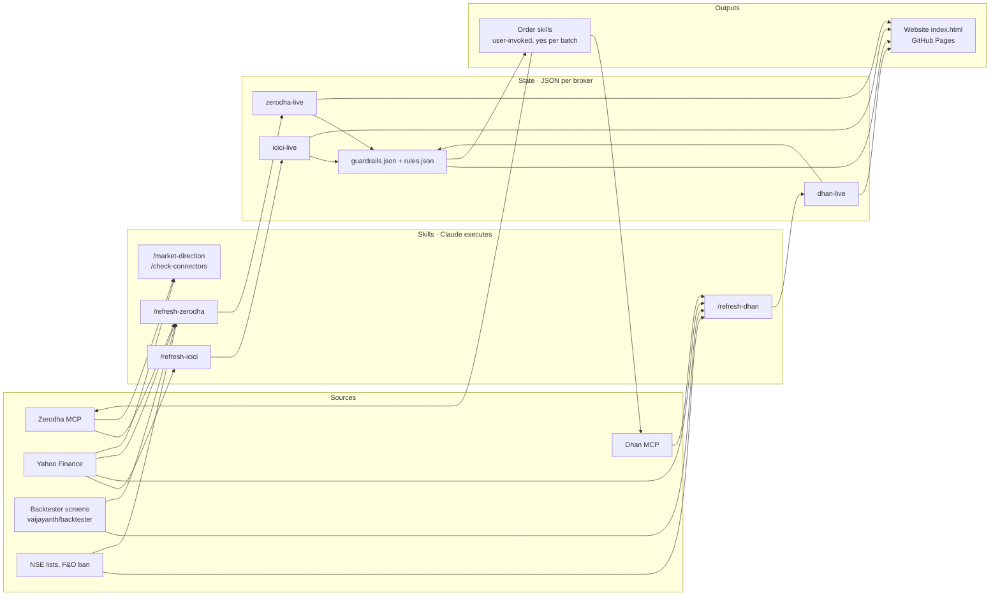
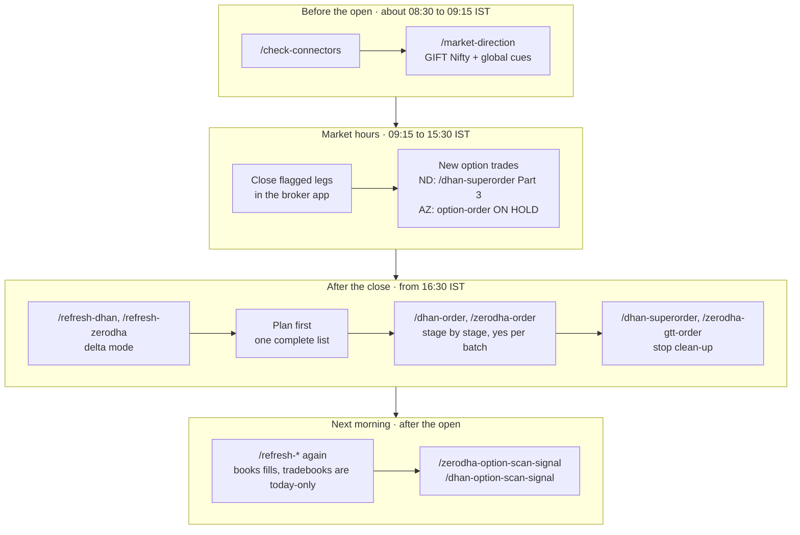

# VJ TradeIQ: Architecture and Process Flow (ND · AZ · DI)

As of **2026-11-25**. This is the reference for how the system is built, how a trading day runs, and where to change things. It replaces the 16 Nov version (which mirrored a Claude Doc artifact; the repo copy is now the source). Rules live in `CLAUDE.md` (core) and `docs/rules/` (by topic); this file explains how the pieces fit and what to touch for a given change.

## 1. The design in one page

The stack follows one idea: **prose tells agents what to do, JSON carries state, code gates anything that touches money, and a human says yes.**

| Layer | What it is here | Where it lives |
|---|---|---|
| Instructions (Markdown) | Core rules, topic rules, skills | `CLAUDE.md`, `docs/rules/*.md`, `.claude/skills/*/SKILL.md` |
| Configuration (JSON) | Trading numbers, option settings, guardrail thresholds, exclusions | `{broker}-live/data/rules.json`, `cc_config.json`, `guardrails_config.json`, `excluded_*.json` |
| Communication (JSON) | Snapshots the website and skills read | `{broker}-live/*_signals.json`, `covered_call_signals.json`, `guardrails.json`, `insights.json` |
| Integrations (APIs) | Broker connectors (MCP), Yahoo Finance, NSE lists, the backtester's published screens | Zerodha MCP, Dhan MCP, Yahoo, NSE archives, `vaijayanth/backtester` |
| Execution (agents) | Claude running the refresh, scan and order skills | `.claude/skills/` |
| Judgment (human) | "yes, place these" per batch, "push" for code and docs, broker-app steps | You |
| Deterministic gates (code) | Guardrails, order gate, ticket builders, consistency check, tests | `scripts/guardrails.py`, `order_gate.py`, `build_*_ticket.py`, `scripts/check_rules_consistency.py` |

Design rules that follow from it: code only where a wrong answer costs money (gates, builders, backtests); every gate has a failing-input test; a number lives in one file; a rule change is a JSON edit plus a consistency check, not a hunt through prose.

Read left to right: connectors and public data feed the refresh skills; each refresh writes only its own broker folder and runs the guardrail check; the website and the order skills read only those snapshots. **ND, AZ and DI share no code and no data.** A rule change is made in that broker's own copy.

## 2. Repository map

| Path | Purpose |
|---|---|
| `index.html` | The whole website (single file, GitHub Pages from branch `claude/beautiful-hamilton-fwa55n`). Workspaces ND/AZ/DI, contract-driven pages, Covered Call page, Options book check panel |
| `dhan-live/` (ND) | Dhan snapshot, fills ledger, engine, guardrails, order and option scripts, `data/` (rules, config, raw MCP text under `cc_raw/`) |
| `zerodha-live/` (AZ) | Same shape for Zerodha plus GTT scripts, move-from-sheet baseline, `scan_gtts.py` |
| `icici-live/` (DI) | Dividend universe, 52-week-low entry, covered call, `build_gtt_levels.py` (calculated stop/target), manual positions import |
| `.claude/skills/` | The skills (section 6) and `_shared/` (`output-format.md`, `holds.md`) |
| `scripts/` | `check_rules_consistency.py`, `sync_skill_blocks.py`, `market_direction.py`, `action_items.py`, `ivp_update.py` (daily IV history + per-broker `data/ivp.json`), `ivp_scan.py` (rank by IVP) |
| `market-data/` | `iv_history.json`: ATM IV per F&O stock per day from the NSE bhavcopy (committed, about 1 MB; the raw bhavcopy cache is git-ignored under `options-backtest/data/`) |
| `swing-backtest/` | The backtest engine, scripts and `results/`; `RESULTS.md` is the table of record |
| `docs/` | This file; `rules/` (topic rules); archives of the legacy sheet system, options plan, journal, redesign |
| `reports/`, `research_notes/` | Research outputs (Bonde EP and Minervini entries) |
| `CLAUDE.md` | Core operating rules, strategy table, backtest reference, index of topic files (about 18 KB) |
| `OPTIONS_STRATEGY_V2.md` | Agreed future option rules (defined-risk spreads); not built |

## 3. The three workspaces

| | ND (Dhan, dh252) | AZ (Zerodha, Nifty F&O) | DI (ICICI, dividends) |
|---|---|---|---|
| Data source | Dhan MCP | Zerodha MCP | Yahoo and NSE lists; positions keyed by hand from ICICIdirect |
| Entry | Close above the 252-session **closing** high and Supertrend(10,3) green; **today's signal only** | Supertrend flipped to green within the **last 3 trading days**, still green, not held | Close at a new 252-session closing low; Rs20,000, once a week per stock |
| Exit | Supertrend red, whole position, any P&L | Same (grandfathered positions only after a post-cutoff red flip) | None |
| Add-on | Green and P&L <= -6%: 1/10 quantity (min 1), once per 7 days | Same | n/a |
| Sizing | Rs1,000 + Rs1,000 per 100 closed trades, base Rs20L | Rs20,000 + Rs5,000 per 100 trades (open + closed), base Rs30L | Rs20,000 |
| Option rule | Supertrend colour only: red = sell call, green = bull put spread | RSI > 70 sell call, RSI < 30 bull put, else colour | ND rules on the 23 stocks with options |
| Scope | dh252 stocks; the 10 covered-call investment stocks are a separate book; hedge portfolio excluded | Stocks moved from the old sheet plus positions opened through the new dashboard | 29-stock universe |
| Order skills | `/dhan-order` (six stages), `/dhan-superorder` | `/zerodha-order` (three stages), `/zerodha-gtt-order` | None; `/icici-gtt-order` only lists stop and target levels |

The numbers in the entry, add-on and sizing rows are set in `{broker}-live/data/rules.json` and guarded by `scripts/check_rules_consistency.py` (section 8).

## 4. The daily timeline

1. **Before the open:** `/check-connectors` confirms Zerodha and Dhan are signed in; `/market-direction` reads GIFT Nifty (from the Zerodha MCP, `NSEIX:GIFT NIFTY`) and global cues. Informational only.
2. **Market hours:** options only. Close legs that are past their 3x stop in the broker app (no skill closes them). ND new options go through `/dhan-superorder` Part 3. `/zerodha-option-order` is **ON HOLD** (see `.claude/skills/_shared/holds.md`).
3. **After 16:30 IST:** run `/refresh-dhan` and `/refresh-zerodha`. A refresh runs its read-only builders and scans first, then shows **one** complete plan, then walks you through it one step at a time (plan first, then walk).
4. **Orders:** `/dhan-order` and `/zerodha-order` take one group at a time (exits, add-ons, entries; ND adds the investment shares). Each group is listed, you exclude or confirm, then "yes, place these"; orders are placed after-market and **verified in the order book before the next group is listed**. Empty groups are announced, not skipped.
5. **Clean-up:** `/dhan-superorder` and `/zerodha-gtt-order` remove stale or wrong stops and add protective stops on new shorts.
6. **Next morning:** refresh again to book fills (both tradebooks are today-only), then run the option scans.

**Delta mode** (`refresh_delta.py` in each broker): a refresh fingerprints its inputs and skips the heavy rebuild, chain pulls and insights rewrite when nothing structural changed on the same IST day, then reports only what changed since the last run. Login, fills, live prices, the covered-call engine, guardrails and the F&O ban fetch always run. "Full refresh" forces everything.

## 5. Options: how the book is protected and checked

| Item | Rule |
|---|---|
| Structure | Green = bull put spread (hedge 2 listed strikes lower), red = sell call. A colour flip with the old structure open: close the old legs first (the rule was reviewed on 2026-11-23 and kept) |
| Strike distance | About 10% away for the current month, 15% for a later month; never place on a stale price |
| Protection, ND | Super orders: stop at 3x the sold premium, target at 40% of it, trailing jump 0.05 (BANKINDIA 0.01) |
| Protection, AZ | Two-leg GTT: stop trigger 2.75x (limit 3x), target trigger at 40%. Trailing GTTs cannot be created or converted by the tool; leave existing ones |
| DI | No broker link: stop and target are **calculated** from the rules (`/icici-gtt-order` lists them for manual placement) |
| Alerts | Types: 3x premium, Through hedge, Beyond strike, Near strike, Exit (colour flipped), Profit Exit (60% decayed), Event close (15 days before results or ex-dividend), Expiry risk (physical delivery), Leftover hedge, No GTT / No stop placed, Invalid GTT / Invalid stop order, New trade |
| Exit criteria | The full list (3x premium, through hedge, beyond strike, stop problems, expiry risk, event close, colour flip, F&O ban, profit exit, near strike, orphaned long) with thresholds is in `docs/rules/options-and-covered-call.md` under 'Option exit criteria' |
| F&O ban (2026-11-26) | A held stock in the NSE ban period raises an EXIT alert `F&O ban` (close the structure: no rolling or new legs allowed). Fetched by every refresh into `data/fno_ban.json` |
| IV percentile (2026-11-26) | `ivp_update.py` runs before the rebuild in all three refresh skills; each engine copies `ivp` / `iv` / `ivr` from its own `data/ivp.json` into `covered_call_signals.json`; IVP column on the Actions / Alerts / Trades tables and the entry-tier lists. Information only, no rule uses it |
| DI near-stop warning (2026-11-26) | DI only: a short at 2.5x its sold average or more (below 3x) raises a WARN `Near 3x stop` (`near_stop_multiple` in `icici-live/data/cc_config.json`) |
| Re-sell PE | A long put left after the short put hit its profit target, on a still-green stock, is an entry signal (a `Re-sell PE` row on the Entry tab) |
| Options book check | Panel on the Covered Call page and a section of the report: trend match, hedge, stop and target per stock, attention-first; ND in the report table, AZ and DI attention-only |
| Scans | `scan_options.py` sections A to G (orphaned longs, unhedged puts, no stop, stop fired but not fixed, trigger passed, hygiene, stop with no target), `scan_super_orders.py` (S1 to S4, multi-order coverage grouped), `scan_gtts.py` (G1 to G7) |

## 6. Skills

Eighteen skills; only those marked "places orders" can touch money, and each is user-invoked only.

| Command | Broker | What it does | Places orders? |
|---|---|---|---|
| `/check-connectors` | Both | Read-only: is Zerodha and Dhan signed in, or does one need re-authentication | No |
| `/market-direction` | Both | Pre-open bias from GIFT Nifty (Zerodha MCP) plus global cues, Nifty regime and VIX; informational only | No |
| `/action-items` | Both | One prioritized list of everything pending | No |
| `/refresh-dhan` | ND | Pull, rebuild, guardrails, scans, plan, insights, push of data files | No |
| `/refresh-zerodha` | AZ | Same, plus GTT scan | No |
| `/refresh-icici` | DI | Yahoo-based build, DI entry signals, calculated option levels | No |
| `/dhan-order` | ND | Six stages: swing exits, add-ons, entries; investment-share exits, averaging, entries | Yes, after-market |
| `/zerodha-order` | AZ | Three stages: exits, add-ons, entries | Yes, after-market |
| `/dhan-superorder` | ND | Scan and fix option stops (your yes per cancel); new option as a super order | Yes |
| `/zerodha-gtt-order` | AZ | Scan GTTs, delete stale ones, place protective two-leg GTTs | Yes (GTTs) |
| `/icici-gtt-order` | DI | Lists stop and target levels to place by hand | No |
| `/dhan-option-entry-signal`, `/zerodha-option-entry-signal` | ND, AZ | Five-tier option entry list by flip age, with the Supertrend table for stocks with open legs | No |
| `/dhan-option-exit-signal`, `/zerodha-option-exit-signal` | ND, AZ | Exit list by rule type, most urgent first | No |
| `/dhan-option-scan-signal`, `/zerodha-option-scan-signal` | ND, AZ | Health scan of every open option leg | No |
| `/zerodha-option-order` | AZ | New AZ option trades, hedge first. **ON HOLD**: never suggested | Yes (on hold) |

**Output standards (user rules, apply to every skill):** tables only, small and attention-first; next steps are always a table `# | Type | Do | Command or app | When` followed by one `Next step:` line; skill steps and manual broker-app steps are never mixed; reports stay on one screen. The shared block lives in `.claude/skills/_shared/output-format.md` and is written into 7 skills by `scripts/sync_skill_blocks.py`.

## 7. Guardrails and hard rules

A refresh ends with a guardrail check per broker (`guardrails.json`); no order ticket is built unless it is current and clear.

| Rule | Meaning |
|---|---|
| Levels | BLOCK (no order for that stock, or for all if global), WARN (look first), INFO |
| Checks | F freshness, I integrity, S signal logic re-derived, C capital and concentration, O orders, P options, X separation, H kill switch (full list in `docs/rules/guardrails.md`) |
| Price cross-check (F5) | A mass disagreement (25% or more of 4+ signals) is a global block; single-signal flags are advisory because the backtester's signal is final |
| Splits (I8) | An unrecorded split blocks that stock; matching holdings records it automatically, mergers and demergers stay manual |
| Kill switch | `data/trading_halt.json`; flipped only when you ask |
| One yes per batch | An earlier yes never carries over; a rejected order is reported and never re-sent unchanged |
| Never weaken a BLOCK | Fix the data instead |
| Push rules | Data refreshes are pushed without asking unless a BLOCK is open or the result looks wrong; orders, GTT changes, moving positions, and code, skill or docs edits wait for your "push" |

## 8. How to change things (read before editing)

| You want to change | Edit | Then run | Also check |
|---|---|---|---|
| An entry window, add-on trigger, fraction, cooldown, ladder or capital | `{broker}-live/data/rules.json` | `python scripts/check_rules_consistency.py` | It lists any page copy, strategy table, skill text or signals file that disagrees; fix those, refresh to regenerate the signals file |
| Output formatting rules for skills | `.claude/skills/_shared/output-format.md` | `python scripts/sync_skill_blocks.py`, then `--check` | `zerodha-option-order` keeps a frozen copy on purpose |
| Put a skill on hold or release it | `.claude/skills/_shared/holds.md` and the skills that mention it | `check_rules_consistency.py` | Every skill that names a held skill must say ON HOLD |
| Option settings (deltas, 3x, 60% decay, event window) | `{broker}-live/data/cc_config.json` | Refresh the broker | Page rules text and the skills' wording |
| Guardrail thresholds | `{broker}-live/data/guardrails_config.json` | `test_guardrails.py` | Never duplicate a key that is in `rules.json` |
| A new guardrail check | Add to **both** brokers' `evaluate()` and `test_guardrails.py` | Both test files | Every check needs a failing-input test; keep thresholds in config |
| A rule in prose | The matching `docs/rules/*.md` (or the core list in `CLAUDE.md`) | None | Dated notes override older ones; core rules win over topic files |
| The page | `index.html` | Open it locally and check ND, AZ, DI | Page fallbacks must match `rules.json` (the checker greps them) |
| A strategy change | Backtest it first in `swing-backtest/` | Add the result to `RESULTS.md` and the `CLAUDE.md` backtest reference | Run a walk-forward split; no rule change below 90 days or 30 closed trades live |

Hard separation: never import across `dhan-live`, `zerodha-live` and `icici-live` (guardrail X1 scans for it). Shared top-level scripts may read configs for checks but must not influence signals.

## 9. Backtest reference (10 years, 6% idle cash, costs and 0.1% slippage)

| Strategy | CAGR | Max DD | PF | Win % | Note |
|---|---|---|---|---|---|
| ND live (Rs20L, Rs1k + Rs1k) | 28.0% | -15.4% | 2.01 | 41 | 35.8% before 2022 and about 20 to 23% after; 2020 and 2021 carried the headline |
| AZ live (flip-today, Rs30L) | 20.2% | -21.3% | 1.75 | 41 | The 3-day window and flip-today are the same within noise |
| Dhan entry on the F&O universe | 15.6% | -12.8% | 2.22 | 43 | Fewer trades, lower return, shallower drawdown |
| ND + Trend Template | 24.7% | -11.5% | 2.10 | 42 | Rejected: the drawdown benefit does not survive a restart on 2022-01-01 |
| ND + volume or +4% filters | 27.2 to 27.3% | -13.8 to -14.4% | 2.02 to 2.08 | 41 to 42 | Neutral |
| Nifty-red entry gate | ND 23.6%, AZ 13.3% | ND -12.6%, AZ -26.3% | n/a | n/a | Hurts AZ |
| Gold hedge overlay | ND 31.5%, AZ 22.8% | ND -16.0%, AZ -23.6% | n/a | n/a | Return came from gold rising, no drawdown cut |
| Bonde EP and Momentum Burst sleeves | n/a | n/a | 0.8 to 1.0 at 3 to 5 days | 40 to 43 | Flat or negative at Bonde's hold window; positive only at 10 to 20 days |

A win rate near 41% is normal for these systems. Tables of record: `swing-backtest/RESULTS.md`; research: `reports/Bonde episodic pivot Minervini entries 2.md` (Bonde's own posts verified, Minervini numbers still unverified). Caveats: survivorship bias, dividend-adjusted prices, no circuit or liquidity limits, no tax. Plan on about 20% CAGR and -15% drawdown for ND going forward.

## 10. Connectors and environment

| Item | Fact |
|---|---|
| Zerodha session | The Kite session expires at 06:00 IST daily and the connector refreshes it; orders also need Zerodha's own approval (browser link) |
| Dhan session | Signs out unpredictably; reauthorise in the claude.ai connector settings (this session cannot start the sign-in). `/check-connectors` finds it |
| MCP pagination | The Zerodha MCP returns 100 rows per call; merge pages (use `limit` 500) before the scripts |
| GIFT Nifty | Not on Yahoo. Zerodha MCP `market quote` on `NSEIX:GIFT NIFTY` gives the live level; Dhan lists it (`IDX_I` 5024) but returned no live level |
| Allowed hosts | Yahoo, `api.kite.trade`, `nsearchives.nseindia.com`, plus Stockbee, TraderLion, ChartMill, MarketInOut, Substack and TradingQnA (added 2026-11-25; the web-fetch tool still fails DNS on most, `curl` works for Stockbee) |
| Plugin servers | GitHub, Slack and similar plugin servers fail through the proxy; none of the skills use them |

## 11. Known gotchas and open items

| Gotcha | What to do |
|---|---|
| Both tradebooks are today-only | Refresh every trading day or fills are lost |
| Fresh buys are absent from holdings until settlement | Expected; the guardrail warns |
| Dhan's pre-trade funds check returns a wrong shortfall | `/dhan-order` retries with the check skipped after your "yes" for the group; real errors still stop |
| Zerodha rejects prices off the tick size | Round down to the tick |
| GTT writes fail with a bare 'Failed to place/delete GTT order' | Needs one browser order approval first; recipe in `.claude/skills/zerodha-gtt-order/SKILL.md` (harmless out-of-band AMO order, only with your yes) |
| Tiny-premium, large-quantity GTTs can be refused with no reason | Use a stop-only GTT or place it in Kite |
| Yahoo has no bar on an Indian holiday | `/market-direction` flags "no cash session since <date>" |
| Daily candles pulled late can carry the last traded price | Re-pull after settlement before trusting a flag |

| Open item (26 Nov 2026) | Status |
|---|---|
| ND AMO orders (22) and AZ AMO orders (ASHOKLEY, POWERINDIA, TORNTPHARM) placed 25 Nov | Run `/refresh-dhan` and `/refresh-zerodha` after the open to book the fills |
| BSE 4200CE against a green colour; BSE 3200PE unhedged (ND) | Close or hedge in the Dhan app |
| NATIONALUM and NMDC put spreads, APLAPOLLO 1920CE (F&O ban), CUMMINSIND GTT swap (AZ) | Close the spreads and APLAPOLLO in Kite; the CUMMINSIND trailing stop (50) to a 59.95 / 8.70 two-leg GTT waits for the user's yes |
| DI: NATIONALUM and NMDC spreads, CDSL 1500CE, TCS spread (profit), IOC and LICI unhedged puts, GOLDBEES buy (recorded 26 Nov) | Manual in ICICIdirect |
| Session-start hooks | CLAUDE.md says a hook runs the stale-refresh check and the move-candidate nudge, but `.claude/settings.json` holds only the branch-switch hook; run `python dhan-live/scripts/stale_check.py` and `python zerodha-live/scripts/stale_check.py` yourself, or add the hook |
| `zerodha-option-order` | On hold since 2026-11-17 |
| Options strategy v2 | Agreed, not built (`OPTIONS_STRATEGY_V2.md`) |
| DI positions upload | Manual keying only; no connector |
| Trend Template walk-forward | Done and rejected; no live change |
