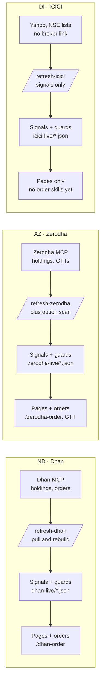
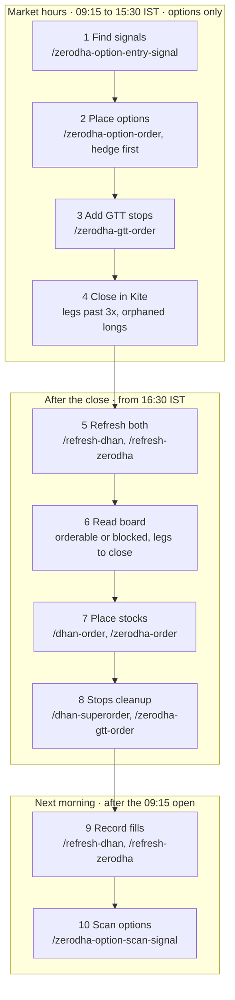

# VJ TradeIQ — Daily Process Flow (ND · AZ · DI)

As of 2026-11-16. Reference copy of the Claude Doc "VJ TradeIQ — Daily Process Flow"
(https://claude.ai/artifact/VErEEX7n4q38NAv32ixpUb). To be revisited; the open items at the end are a snapshot of 16 Nov.

## How the system fits together

Three separate pipelines turn broker data into signals, pages and orders, and nothing is placed without your yes.

Read each row left to right. The refresh skill writes a snapshot and runs the guardrail check; the website and the order skills read only that snapshot. ND, AZ and DI share no code or data. Orders go in only after your yes; fills come back through the next refresh.

## The daily timeline

Run options live during market hours, run both refreshes and the stock orders after 16:30 IST, and record the fills the next morning.

The top row (steps 1 to 4) is AZ options during the session. The middle row (steps 5 to 8) is refresh, read the board, place orders, clean up stops. The bottom row (steps 9 and 10) is the morning after, because both brokers' tradebooks are today-only.

## ND (Dhan): swing strategy plus investment shares

ND runs two share strategies and an option book on one Dhan account, and every order goes in after the close as an after-market order for the next open.

1. **After 16:30 IST, run `/refresh-dhan`.** It pulls holdings, today's tradebook, the order book, option positions, super orders and live prices, rebuilds the signals, and runs the guardrails.
2. **Read the action board it prints.** It lists orderable and blocked signals, option alerts, and the stop-order clean-up.
3. **Run `/dhan-order`.** Six stages, one at a time, each with its own "yes, place these": dh252 exits, dh252 add-ons, dh252 entries, then share exits, share averaging and share entries.
4. **Run `/dhan-superorder`** for option stop cleanup and for any new option you name.
5. **After the next open, run `/refresh-dhan` again.** The Dhan tradebook is today-only, so this is what records the fills.

| Part | Entry | Add-on | Exit |
| --- | --- | --- | --- |
| dh252 swing (base ₹20,00,000) | 252-day closing high and Supertrend green, today's signals only; size ₹1,000 tier, whole shares, minimum 1 | P&L at -6% or worse, 1/10 of the quantity, once a week | Supertrend red, whole position |
| Investment shares (10 covered-call stocks) | Supertrend flips to green; size = last position's capital plus its profit | Green and down 6% or more, once a week | Supertrend red and in profit; a red loser is held |
| Options | Red = sell the 0.10-delta call; green = bull put spread (0.15-delta put, hedge 2 strikes lower) | None | Premium reaches 3x sold (super order stop), or the colour flips |

## AZ (Zerodha): Nifty F&O stocks and the option book

AZ trades Nifty F&O stocks on a Supertrend rule and runs a large option-selling book, so it has more skills than ND: one for stocks, three for options, and one for GTT stops.

1. **After the close, run `/refresh-zerodha`.** It pulls holdings, today's trades, orders, option positions, live prices and GTTs, rebuilds the signals, runs the option position scan (step 5e), and prints the action board.
2. **Stocks: run `/zerodha-order`.** Three stages, one at a time: exits (sell at market), add-ons, then entries (limit orders, today's flips only).
3. **Options, find the signals: run `/zerodha-option-entry-signal`.** Read-only. Five tabs by how recently the Supertrend flipped, with results and ex-dividend alerts on every row.
4. **Options, place new trades: run `/zerodha-option-order`** during market hours, up to 4 stocks per instruction. The hedge goes in first, then the short.
5. **Protect every short: run `/zerodha-gtt-order`.** Part 1 deletes stale or wrong GTTs. Part 2 places a two-leg GTT on each short with none: stop at 3x the sold premium, profit target at 40% of it.
6. **Check the book any time: run `/zerodha-option-scan-signal`.** It finds orphaned long legs, unhedged short puts, shorts with no stop, GTTs that fired but did not fix the position, and passed triggers.
7. **Close what no skill closes, in the Kite app:** legs already past their 3x stop, and orphaned longs you decide to sell.

| Part | Rule |
| --- | --- |
| Scope | Stocks moved from the old sheet plus positions opened through the new dashboard; base ₹30,00,000 |
| Entry | Supertrend flipped to green today, no open position; ₹20,000 tier, +₹5,000 per 100 trades |
| Add-on | Green and down 6% or more, 1/10 of the quantity, once a week |
| Exit | Supertrend red, whole position; positions held at the cut-off exit only after a red flip that happens later |
| Options | Green = bull put spread, red = sell call; strike about 10% away this month, 15% for a later month; stop 3x; profit at 60% decay; close 15 days before results or ex-dividend |

Option entry tiers (page and `/zerodha-option-entry-signal`): Tier 1 flipped on the latest session, Tier 2 within the last trading week, Tier 3 within 30 days, Tier 4 within 90 days, Tier 5 older than 90 days. Stocks with open option legs are left out; Supertrend only, no RSI.

## DI (ICICI): dividend portfolio

DI is the smallest workspace: a 29-stock dividend universe with two pages, Dashboard and Covered Call, and no order skills yet.

1. **Run `/refresh-icici`.** It pulls Yahoo prices and dividend history, finds new 52-week closing lows, and builds the covered-call signals. It needs no broker connection.
2. **Read the Dashboard.** Entry rows are highlighted. It also shows dividend yield, rupees per year on ₹20,000, last and next ex-dividend dates, and options status.
3. **Buy by hand in ICICIdirect.** When a stock closes at a new 252-session closing low, you add ₹20,000 (whole shares, minimum 1), at most once a week per stock.
4. **Covered Call page** uses the ND rule: Supertrend colour only, on the 23 stocks that have listed options.

Not built yet: loading your ICICIdirect holdings and positions from an uploaded export, so DI shows no option alerts and cannot yet enforce the weekly buy limit beyond what you record in `di_trades.json`.

## Skill cheat sheet

Ten commands cover everything; only the five marked "places orders" can touch your money, and each of those is user-invoked only.

| Command | Broker | What it does | Places orders? | When |
| --- | --- | --- | --- | --- |
| `/refresh-dhan` | ND | Pulls Dhan data, rebuilds signals, runs guardrails, prints the action board | No | After 16:30 IST, and after the next open |
| `/dhan-order` | ND | Six stages: dh252 exits, add-ons, entries; share exits, averaging, entries | Yes, after-market | After a clean refresh |
| `/dhan-superorder` | ND | Scans option stops; cancels or fixes with your yes; places a new option super order | Yes | Market hours for new options |
| `/refresh-zerodha` | AZ | Pulls Zerodha data, rebuilds signals, runs the option scan, prints the board | No | After the close, and after the next open |
| `/zerodha-order` | AZ | Three stages: exits, add-ons, entries | Yes, after-market | After a clean refresh |
| `/zerodha-option-entry-signal` | AZ | Option entry signals in five tiers by flip age, with event alerts | No | Before placing options |
| `/zerodha-option-order` | AZ | Places new option trades, hedge first, then the short | Yes | Market hours only |
| `/zerodha-gtt-order` | AZ | Deletes stale GTTs; places two-leg protective GTTs on shorts | Yes (GTTs) | After any new short |
| `/zerodha-option-scan-signal` | AZ | Health scan of every open option leg | No | Any time |
| `/refresh-icici` | DI | Builds entry signals and covered-call signals from Yahoo | No | Daily |

After every skill run, the next command for the same broker is named for you. ND and AZ never share code or data.

## Guardrails and hard rules

A refresh ends with a guardrail check per broker, and no order ticket can be built unless that check is current and clear.

| Rule | What it means |
| --- | --- |
| BLOCK stops orders | A global block (stale data, suspect prices, a mass exit, the kill switch) stops every ticket; a per-stock block stops only that stock |
| F5 price cross-check | Recomputes each signal from independent Yahoo history; if 25% or more disagree, nothing is ordered until the close data is published and the refresh is re-run |
| Kill switch | `data/trading_halt.json` stops all orders; it is flipped only when you ask |
| One yes per batch | Every order stage shows the exact ticket and waits for "yes, place these"; an earlier yes never carries over |
| No retries | A rejected order or GTT is reported verbatim and never re-sent unchanged |
| After-market orders | Stock orders are placed after the close for the next open, never during market hours; option orders are the exception and need the market open |
| Separation | ND, AZ and DI share no code or data; a rule change is made in that broker's own copy |
| Push rules | Read-only work and data refreshes are pushed without asking, except while a guardrail block is open or a result looks wrong, which are raised with you first; orders, GTT changes, moving positions, and code, skill or docs edits wait for your permission or your "push" |
| Staleness | When the market is open and the last refresh is over an hour old, a banner and a session-start reminder tell you to refresh |

## Known gotchas and open items

Most surprises come from timing and from broker quirks; the first table is what bites in daily use, the second is what is still open as of 16 Nov 2026.

| Gotcha | What to do |
| --- | --- |
| Dhan and Zerodha tradebooks are today-only | Refresh every trading day or fills are lost |
| Fresh buys are missing from holdings until settlement | Expected; the guardrail warns and positions show later |
| Dhan's funds pre-check returns a wrong shortfall | Skipped only after your explicit yes, order by order |
| Zerodha rejects prices off the tick size, and orders need Zerodha's own approval | The skills round to the tick and give you the approval link |
| Large-quantity, tiny-premium GTTs can be refused with no reason | Place a stop-only GTT or place it in Kite |
| Daily candles pulled late can carry the last traded price, not the official close | Re-pull after settlement before trusting a flag |
| The safety classifier sometimes returns no verdict | Retry once; if it keeps failing, run the same git steps yourself |

| Open item | Status |
| --- | --- |
| ND F5 block (HONASA, LICHSGFIN, MSTCLTD) | Clears after the close data is published; re-run `/refresh-dhan` after 16:30 IST |
| PASHUPATI 2.5-for-1 split of 13 Nov | Not recorded; waiting on whether the extra shares were credited |
| Legs past their 3x stop (DIVISLAB, HDFCBANK, HINDPETRO, MAHABANK, NAM-INDIA) | Close in Kite; no skill closes them |
| Share averaging due (SHRIRAMFIN, DIXON, HCLTECH, INFY, BANKINDIA, BPCL) | Due after the 16 Nov close |
| DI holdings and positions upload | Not built |
| Broker-switch UX matrix | Three pairs, a reload on each broker and the phone layout still to run |
